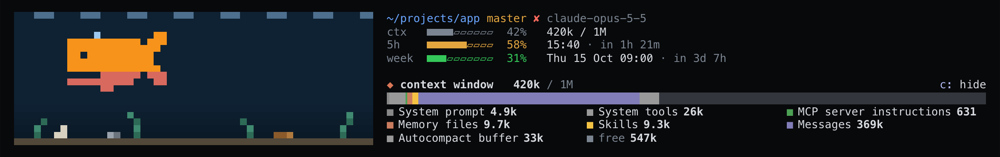
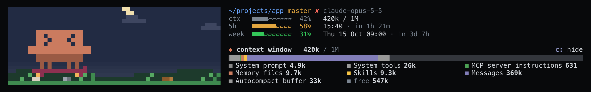

# claude-mods

Mods for [Claude Code](https://claude.com/claude-code): plugins that draw inside the
terminal. This repo is a plugin marketplace, so each mod installs by name. There is one
so far, **PixBar**. See it moving at [pixbar.dev](https://pixbar.dev).

## Install

At the Claude Code prompt (not your shell):

```
/plugin marketplace add ke11/claude-mods
/plugin install pixbar@claude-mods
```

1. Pick the **user** scope, so it shows up in every folder.
2. Start a new session. The whale appears above the prompt.
3. Trust the folder when Claude Code asks. It loads no mods in an untrusted folder,
   and says nothing about it.

Update, disable or remove it from `/plugin`.

## PixBar

A pixel creature in a small world, above your prompt. It shows what Claude is doing
and how much room you have left, so you can tell at a glance without reading the
transcript.

**Whale**, in the sea (the default):



**Clawd**, on land (`/pixbar theme clawd`):



Both show the same moment: Claude answering, 42% of the context used, 58% of the
five-hour window, and uncommitted work (the litter on the floor). Under the meters is
the context window by category; press `c` to hide it.

### What it shows

| Signal | Whale, in the sea | Clawd, on land |
| --- | --- | --- |
| Context used | fills with colour from the belly up, one pixel row per tenth | the same |
| Five-hour window | swims higher as you use it: 0% on the seabed, 100% at the surface | the moon crosses the sky and sets as it runs out |
| Uncommitted work | seagrass and litter on the seabed; a commit clears it | tufts and litter on the grass; a commit clears it |
| Idle | parked, blinking now and then | parked, its skateboard beside it |
| Thinking | bobs, with sonar from the snout | stands still, blinking |
| Running tools | swims fast, a bubble for every tool call | waves its wand; dust on every tool call |
| Answering | spouts at the surface | skates, jumping once a beat |

Beside the creature:

- folder, branch and model;
- context in tokens against the session's limit, as `/context` counts it;
- each rate-limit window (five-hour, weekly) with its reset time;
- the context window by category: system prompt, tools, MCP, memory, skills, messages.
  Press `c` to hide or show it.

Rate limits come from a Claude subscription. With an API key there are none to show,
and the whale rests on the seabed.

### Commands

| Command | What it does |
| --- | --- |
| `/pixbar` | A menu: your theme and layout, and the command to change each. |
| `/pixbar theme whale` | The whale, in a sea. The default. |
| `/pixbar theme clawd` | Clawd, on land. Your pick is kept for the next session. |
| `/pixbar layout band` | Above the prompt. The default. |
| `/pixbar layout pane` | A pane of its own, beside the transcript, for this session. |
| `c` | Hide or show the context-window breakdown. |

`/pixbar clawd` and `/pixbar pane` work as shortcuts.

**Settings.** `/plugin configure pixbar@claude-mods` sets both the theme and the layout.
The theme there and `/pixbar theme` are the same choice: whichever you set last is used.

**Keeping the pane.** `/pixbar layout` lasts for the session. To make it permanent, set
`placement` to `pane` there. The pane docks beside the transcript in fullscreen;
opened at startup it needs a terminal at least 144 columns wide. Closing the pane sends
the creature back to the band.

### Creatures

Each creature is a skin file:

| Where | What |
| --- | --- |
| [`pixbar/skins/whale.sh`](pixbar/skins/whale.sh) | The whale. It is also built into the mod, so it still swims if no skin file can be read. |
| [`pixbar/skins/clawd.sh`](pixbar/skins/clawd.sh) | Clawd, with `HABITAT='land'` and a skateboard. |
| `~/.claude/pixbar/skins/<name>.sh` | Your own. They show up in `/pixbar` next to the shipped ones. |

Your pick is kept for the next session. `/pixbar theme whale` goes back to the whale.

### Make your own creature

A skin is a shell-style file that PixBar reads as data; it is never run. Copy
`whale.sh`, set `SKIN_NAME` to your creature's name, save it as
`~/.claude/pixbar/skins/<name>.sh`, then run `/pixbar theme <name>`.

| Field | Meaning |
| --- | --- |
| `SKIN_NAME` | Its name; match the file name. |
| `W` | Width in pixels, 8 to 40. The height is always 10. |
| `NFRAMES` | Working poses, 2 to 6. One more frame follows them: the idle pose. |
| `IDLE_FRAME` | Which frame is the idle pose; defaults to the last. |
| `FRAMES` | `(NFRAMES + 1) × 10` rows, each `W` digits: `0` empty, `1` body, `2`–`4` extra inks. |
| `DIRTY` | 10 rows of `W` digits: `1` marks the pixels that turn cream on uncommitted work. |
| `SKIN_BASE`, `SKIN_GAUGE`, `SKIN_CREAM` | Body colour, context fill and uncommitted-work colour, as `'r;g;b'`. |
| `SKIN_INK2`…`SKIN_INK4` | Colours for digits `2`–`4`. |
| `HABITAT` | `sea` (swims) or `land` (walks on grass under a night sky). |
| `RIDE` | `skateboard`: rides it while answering (land only). |

A file that doesn't parse is ignored, and the whale is drawn instead.

### Privacy

PixBar reads what Claude Code passes it and your local `git status` (every five
seconds). It writes no file and makes no network calls; your theme is kept in the mod's own
store. The full list of what it
reads, writes and runs is in [pixbar/README.md](pixbar/README.md).

## Troubleshooting

- **Nothing shows.** Almost always folder trust: answer yes when Claude Code asks, start
  a new session, and check `/plugin` lists `pixbar` as enabled.
- **No five-hour or weekly meter.** You are on an API key; those windows only exist on a
  Claude subscription.
- **The pane didn't open at startup.** The terminal is narrower than 144 columns. Run
  `/pixbar layout pane` once it's wider, or stay in the band.

## Develop

Working on a mod from a clone: see [CONTRIBUTING.md](CONTRIBUTING.md).

```bash
claude plugin validate pixbar
claude plugin test pixbar
bun scripts/check-whale.ts   # skins/whale.sh still matches the built-in whale
```

## Changes and issues

What changed in each release: [CHANGELOG.md](CHANGELOG.md). Bugs and ideas:
[issues](https://github.com/ke11/claude-mods/issues). Security problems:
[SECURITY.md](SECURITY.md).

## License

MIT. See [LICENSE](LICENSE). An independent project, not affiliated with Anthropic.
